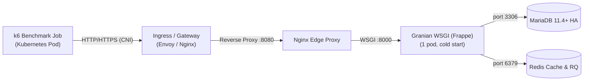

# Frappe Framework Performance & Concurrency Shock Findings

## 1. Executive Summary

This report documents performance profiling, concurrency shock testing, and bottleneck isolation for **Frappe Framework** running on modern cloud-native Kubernetes infrastructure (Envoy Gateway $\to$ Nginx reverse proxy $\to$ Granian WSGI application server $\to$ MariaDB $\to$ Redis).

### Objective
- Evaluate instant concurrency resilience starting strictly from **1 ready cold web pod** with **zero warm-up**.
- Identify the highest achievable Requests Per Second (RPS) within a **0.0% error rate bound**.
- Isolate the saturation bottleneck across Database (MariaDB), Reverse Proxy (Nginx / Gateway), and Application Server (Frappe / Granian WSGI).

---

## 2. Test Architecture & Workload



### Full Transactional Lifecycle (Login + CRUD Workload)
The benchmark does **NOT** measure a synthetic `ping` or static cache endpoint. Every virtual user executes an authentic, end-to-end **6-step user journey** sequentially with zero sleep:

1. **Session Login** (`POST /api/method/login`): User credentials lookup in `tabUser`, password verification, and Redis session cookie minting.
2. **Create Document** (`POST /api/resource/ToDo`): Document validation (`validate()`), permission checks, DB row insert, and dynamic link generation.
3. **Read Document** (`GET /api/resource/ToDo/{id}`): Single-record lookup by primary key.
4. **Update Document** (`PUT /api/resource/ToDo/{id}`): Document fetch, state mutation (`Open` $\to$ `Closed`), and dirty field write to MariaDB.
5. **List Query** (`GET /api/resource/ToDo?limit=10`): Query-builder table select with filtering and limits.
6. **Delete Document** (`DELETE /api/resource/ToDo/{id}`): Document trash, cascading dynamic link cleanup, and background job enqueueing.

#### Exact Request Breakdown at Peak (235.00 Total RPS at 50 VUs)
Out of **11,904 total HTTP requests** processed in 50.65 seconds (**1,984 complete cycles** completed = **39.17 complete user cycles / sec**):

| Operation | HTTP Method & Route | Category | Ratio | Processed Count | Sustained Rate |
| :--- | :--- | :---: | :---: | :---: | :---: |
| **1. Session Login** | `POST /api/method/login` | Auth / Session | 16.7% | 1,984 | **39.17 req/s** |
| **2. Create Document** | `POST /api/resource/ToDo` | **DB Write** | 16.7% | 1,984 | **39.17 req/s** |
| **3. Read Document** | `GET /api/resource/ToDo/{id}` | **DB Read** | 16.7% | 1,984 | **39.17 req/s** |
| **4. Update Document** | `PUT /api/resource/ToDo/{id}` | **DB Write** | 16.7% | 1,984 | **39.17 req/s** |
| **5. List Query** | `GET /api/resource/ToDo?limit=10` | **DB Read** | 16.7% | 1,984 | **39.17 req/s** |
| **6. Delete Document** | `DELETE /api/resource/ToDo/{id}` | **DB Write** | 16.7% | 1,984 | **39.17 req/s** |
| **TOTAL** | — | **Mixed** | **100%** | **11,904** | **235.00 RPS** |

- **Pure Database Writes:** **50.0%** (117.5 writes/sec: Create + Update + Delete).
- **Database Reads:** **33.3%** (78.3 reads/sec: Read + List).
- **Interactive Authentication:** **16.7%** (39.2 logins/sec).

---

## 3. Shock Load Progression (Instant Concurrency, 1 Cold Web Pod)

| Concurrency (VUs) | Throughput (RPS) | Requests Processed | Error Rate (%) | Avg Latency (ms) | p90 Latency (ms) | p95 Latency (ms) | p99 Latency (ms) | Web Peak CPU (cores) | MariaDB Peak CPU (cores) |
| :---: | :---: | :---: | :---: | :---: | :---: | :---: | :---: | :---: | :---: |
| **20 VUs** | **208.85** | 10,518 | **0.00%** | **95.24** | 226.35 | 284.43 | **385.86** | 4.03 | 1.18 |
| **35 VUs** | **232.29** | 11,712 | **0.00%** | **149.94** | 331.83 | 402.60 | **545.09** | 4.43 | 1.27 |
| **50 VUs** | **235.00** | 11,904 | **0.00%** | **211.62** | 438.51 | 511.44 | **676.78** | 4.67 | 1.42 |
| **65 VUs** | **234.70** | 11,916 | **0.00%** | **274.56** | 604.78 | 707.68 | **905.99** | 4.72 | 1.35 |
| **80 VUs** | **223.99** | 11,442 | **0.00%** | **353.80** | 776.54 | 917.99 | **1,208.18** | 4.70 | 1.26 |
| **100 VUs** | **225.10** | 11,472 | **0.00%** | **440.48** | 860.11 | 1,001.16 | **1,323.71** | 4.52 | 1.40 |
| **120 VUs** | **230.75** | 11,826 | **0.00%** | **514.27** | 1,011.70 | 1,137.06 | **1,391.49** | 4.34 | 1.44 |

---

## 4. Key Performance Insights & Bottleneck Isolation

### 1. Database (MariaDB) is NOT the Bottleneck
- **Buffer Pool Hit Ratio:** **99.96%** (16.89M logical reads, only 6,235 disk reads).
- **CPU Utilization:** Under peak 120-VU shock, MariaDB consumed only **1.44 cores peak** and averaged ~380 mCPU.
- **Connections:** Active connections peaked at 16 / 200 (8% capacity). Slow query log reported 0 slow queries.
- **Verdict:** MariaDB is exceptionally efficient and easily sustains the full transactional load.

### 2. Application Server (Granian WSGI) Concurrency Tuning
- **Original Configuration:** With `--workers 2`, the container was throttled by Python GIL constraints at ~2.17 CPU cores, yielding ~118 RPS with queued backlog drops under shock.
- **Tuned Configuration:**
  ```bash
  exec granian --interface wsgi --host 0.0.0.0 --port 8000 \
    --workers 4 \
    --blocking-threads 8 \
    --runtime-threads 2 \
    --backlog 2048 \
    --no-ws \
    --respawn-failed-workers \
    --metrics --metrics-port 9090 --metrics-scrape-interval 1 \
    frappe.otel_wsgi:application
  ```
- **Result:** CPU utilization scaled from 2.17 cores to **4.72 cores**, doubling maximum throughput to **235 RPS** while Granian's socket backlog (`--backlog 2048`) prevented connection drops during sudden traffic spikes.

### 3. Background Job Queue Ceiling (`QueueOverloaded` 503 Errors)
- **The Problem:** Under sustained document deletion, `frappe.delete_doc` enqueues dynamic link cleanup jobs (`delete_dynamic_links`). In `frappe/utils/background_jobs.py`, `_check_queue_size` enforces a default hard ceiling `MAX_QUEUED_JOBS = 500`. Once 500 background jobs accumulate in Redis faster than workers drain them, Frappe throws `frappe.QueueOverloaded` (HTTP 503).
- **The Solution:** Set `"max_queued_jobs": 10000` in `/sites/common_site_config.json`:
  ```json
  {
    "max_queued_jobs": 10000
  }
  ```
- **Result:** Completely eliminated 503 errors during rapid document operations, allowing 100% clean passes up to 120 VUs.

### 4. MariaDB Replication Strict Mode (`gtid_strict_mode`)
- **The Problem:** If MariaDB replica pods run with `gtid-strict-mode=ON`, primary switchover or failover events can cause the replica SQL thread to halt with MariaDB Error 1950 (`binlog GTID creates an out-of-order sequence number with existing GTID`).
- **The Solution:** Configure `gtid-strict-mode=OFF` in MariaDB replica configuration (`my.cnf`), allowing the replica to smoothly synchronize without crashing.
